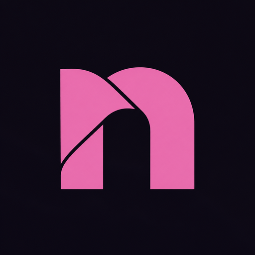

# Novelex — Aplicativo Android

<p align="center">
  
</p>

<p align="center">
  <strong>Dramas Curtos, Romances e Novelas Verticais</strong><br />
  Desenvolvido por <strong>MirDevAps</strong>
</p>

---

## 📱 Sobre o Projeto

**Novelex** é um aplicativo Android nativo desenvolvido para streaming de minisséries, doramas e novelas curtas em formato vertical otimizado para dispositivos móveis e Android TV.

### Principais Funcionalidades

- **Player Vertical Nativo:** Reprodução suave com ExoPlayer (Media3), suporte a HLS (.m3u8), seek interativo e navegação contínua entre episódios.
- **Catálogo Inteligente:** Separação por categorias, destaques, novidades e busca global em tempo real.
- **Multilíngue:** Interface totalmente localizada em Português (Brasil), Inglês e Coreano.
- **Favoritos e Curtidas:** Interação social sincronizada via Firebase Firestore e contadores em tempo real.
- **Modo Offline:** Download de episódios selecionados para reprodução sem conexão à internet.
- **Monetização e Recompensas:** Integração com Google Mobile Ads (AdMob) para anúncios nativos, intersticiais e recompensados para desbloqueio de episódios.
- **In-App Updates & Reviews:** Atualizações automáticas e fluxo de avaliação integrado da Google Play Store.

---

## 🛠️ Stack Tecnológica

- **Linguagem:** Java / Android SDK
- **Compile SDK:** 36 | **Min SDK:** 24 (Android 7.0+)
- **Vídeo & Streaming:** AndroidX Media3 (ExoPlayer + HLS + OkHttp DataSource)
- **Networking:** Square OkHttp 4 + OkHttp DNS-over-HTTPS
- **Imagens:** Bumptech Glide 4
- **Backend / Dados:** Firebase Firestore & Analytics
- **Monetização:** Google Play Services Ads (AdMob)
- **Build System:** Gradle 8.13+

---

## 🚀 Como Compilar o Projeto

### Pré-requisitos
- Android Studio Ladybug ou superior
- JDK 17
- Android SDK 36

### 1. Clonar o repositório
```bash
git clone https://github.com/mirdevaps/Novelex_Android.git
cd Novelex_Android
```

### 2. Configurar Firebase
Certifique-se de manter o arquivo `app/google-services.json` configurado com seu projeto Firebase.

### 3. Configurar Assinatura de Release (Opcional)
Para gerar builds de release assinados, copie o arquivo de exemplo:
```bash
cp keystore.properties.example keystore.properties
```
E configure os caminhos da sua keystore no arquivo `keystore.properties` (que é ignorado pelo Git).

### 4. Build via Linha de Comando
```bash
# Compilar build de debug
./gradlew assembleDebug

# Executar lint e verificações
./gradlew check
```

---

## 🔒 Segurança e Privacidade

- **Política de Privacidade:** [https://mirdevaps.space/apps/novelex/privacy](https://mirdevaps.space/apps/novelex/privacy)
- **Site Oficial:** [https://mirdevaps.space](https://mirdevaps.space)

---

## 📄 Licença

Desenvolvido e mantido por **MirDevAps**. Todos os direitos reservados.
